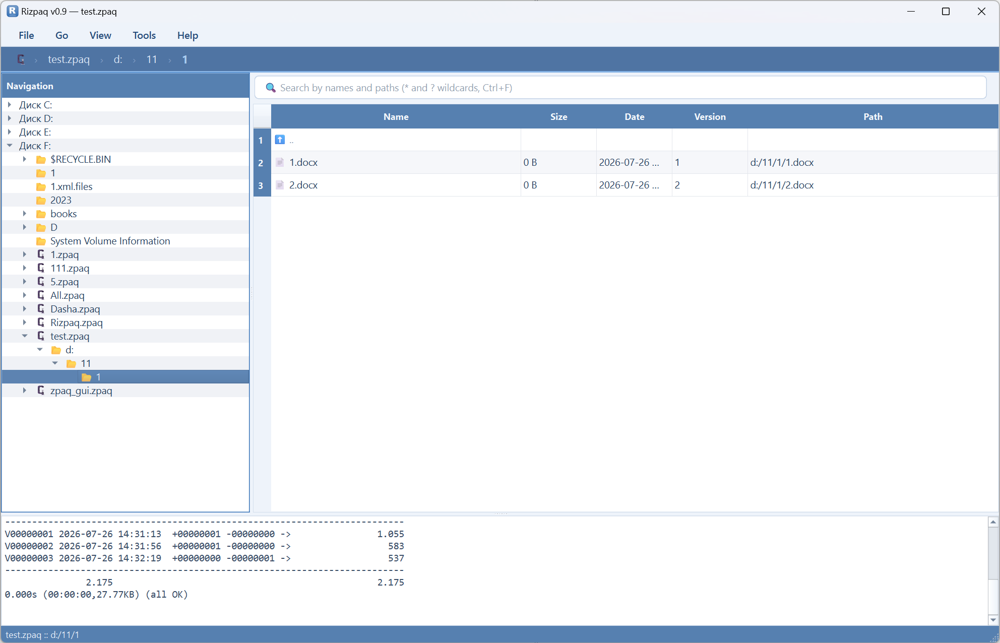

# Rizpaq

Графическая оболочка для архивов **zpaqfranz** / GUI explorer for **zpaqfranz** archives.

## Скриншоты

Главное окно программы:

---

## 🇷🇺 Русский

**Rizpaq** — проводник по архивам zpaqfranz: просмотр как обычные папки, история версий, поиск, сравнение версий и извлечение.

### Установка и запуск
1. Распакуйте архив в любую папку.
2. Положите `zpaqfranz.exe` рядом с `Rizpaq.exe`
   (или укажите путь: **Файл → Путь к zpaqfranz…**).
3. Запустите `Rizpaq.exe`.

Скачать zpaqfranz: http://www.francocorbelli.it/zpaqfranz/

### Portable-режим
Создайте файл `portable.txt` рядом с `Rizpaq.exe` — настройки будут храниться
рядом с программой. Без него — в `%APPDATA%\Rizpaq`.

### Язык
**Инструменты → Язык** — 14 языков, выбор сохраняется.

### Возможности
- единое дерево дисков и архивов;
- версии архива и срезы «на версию»;
- поиск по имени и пути (`*` и `?`);
- сравнение двух версий архива;
- извлечение файлов и папок, отмена извлечения;
- пароль для зашифрованных архивов.

---

## 🇬 English

**Rizpaq** is an explorer for zpaqfranz archives: browse like normal folders,
version history, search, version comparison and extraction.

### Install & run
1. Unpack the archive to any folder.
2. Put `zpaqfranz.exe` next to `Rizpaq.exe`
   (or set the path: **File → Path to zpaqfranz…**).
3. Run `Rizpaq.exe`.

Get zpaqfranz: http://www.francocorbelli.it/zpaqfranz/

### Portable mode
Create `portable.txt` next to `Rizpaq.exe` to keep settings beside the app.
Otherwise they are stored in `%APPDATA%\Rizpaq`.

### Language
**Tools → Language** — 14 languages, your choice is saved.

### Features
- unified tree of drives and archives;
- archive versions and “at version” slices;
- search by name and path (`*` and `?`);
- compare two archive versions;
- file/folder extraction with cancel;
- password for encrypted archives.
